<h1 align="center">Minesweeper</h1>

<p align="center">
  A modern Minesweeper for the browser: no-guessing boards, a hint solver, six colour themes,
  your own pictures, full keyboard play and a 1v1 race for two devices on the same network.
  <br>
  No account, no server, nothing to install for players.
</p>

<p align="center">
  <a href="https://github.com/wjNoah/minesweeper/actions/workflows/ci.yml"></a>
  
  
  
</p>

<p align="center">
  <picture>
    <source media="(prefers-color-scheme: dark)" srcset="screenshots/hero-dark.png">
    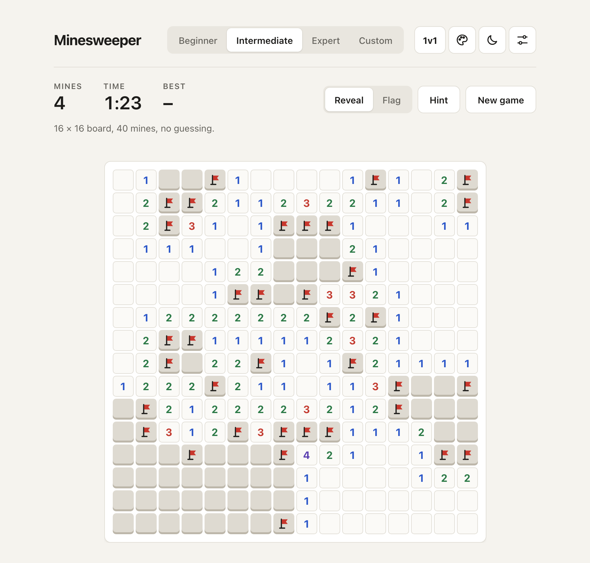
  </picture>
</p>

<p align="center"><sub>Shown in your system's light or dark mode.</sub></p>

## Contents

- [Features](#features)
- [Quick start](#quick-start)
- [How to play](#how-to-play)
- [Game modes](#game-modes)
- [Customize](#customize)
- [On your phone](#on-your-phone)
- [1v1 on the same network](#1v1-on-the-same-network)
- [Project structure](#project-structure)
- [How it works](#how-it-works)
- [Testing](#testing)
- [Deploying (Netlify)](#deploying-netlify)
- [Security notes](#security-notes)

## Features

- **Classic rules done right.** The first click is always safe, empty areas open automatically,
  numbers can be "chorded", and a counter and timer keep score. Best times are saved per
  difficulty.
- **Four difficulties.** Beginner 9×9 with 10 mines, Intermediate 16×16 with 40, Expert 30×16
  with 99, and a custom size.
- **No-guessing mode.** Every board can be solved with logic alone, checked by a real solver, so
  you never face a coin flip.
- **Hints.** One button shows a move that logic proves is right, or a flag that is wrong.
- **1v1 race.** Two devices on the same Wi-Fi or hotspot play the same board. No login, no
  server. You can choose "lose on a mine" or a time penalty.
- **Make it yours.** Six colour themes (each in light and dark), your own background picture,
  your own block picture, and your own flag and mine.
- **Plays anywhere.** Mouse, trackpad, touch and keyboard (arrow keys or W A S D). Nothing needs a
  right-click or a long hold as the only way to do it, and the keys can be changed.
- **Accessible.** Every cell is a real button with a spoken label such as "row 3, column 5,
  flagged". Numbers are never shown by colour alone, text contrast meets WCAG AA (4.5:1), and
  animations switch off if your system asks for reduced motion.
- **Private.** No accounts, no tracking, no network requests. Everything (settings, best times,
  pictures) stays in your browser.

## Quick start

You need Node 22.22.3, 24.15 or newer (`.nvmrc` pins 24).

```bash
npm install
npm start
```

Then open <http://localhost:4200>.

| Command             | What it does                                                          |
| ------------------- | --------------------------------------------------------------------- |
| `npm start`         | Development server at `localhost:4200` with live reload.              |
| `npm run start:lan` | The same, but reachable from other devices on your network (for 1v1). |
| `npm test`          | Runs all unit tests (Vitest) in watch mode.                           |
| `npm run build`     | Production build into `dist/minesweeper/browser`.                     |

## How to play

Reveal every cell that has no mine. A number tells you how many of the 8 cells around it are
mines. Flag the cells you know are mines.

| Action                      | Mouse and trackpad                                                                                                    | Touch                    | Keyboard                                           |
| --------------------------- | --------------------------------------------------------------------------------------------------------------------- | ------------------------ | -------------------------------------------------- |
| **Reveal**                  | Click                                                                                                                 | Tap                      | `Enter` or `Space`                                 |
| **Flag**                    | Switch to **Flag** and click, or point at a cell and press `F`, or `Shift` + click, or right-click / two-finger click | Long press (about 0.4 s) | `F`                                                |
| **Chord** (open neighbours) | Click, double-click or `Shift` + click a number whose flags are all placed, or point at it and press `Space`          | Tap the number           | `Space` or `Enter` on the number                   |
| **Move the cursor**         | Point at a cell                                                                                                       | -                        | `Tab` into the board, then arrow keys or `W A S D` |
| **Hint**                    | **Hint** button                                                                                                       | **Hint** button          | `H`                                                |
| **Switch Reveal / Flag**    | **Reveal / Flag** switch                                                                                              | **Reveal / Flag** switch | `M`                                                |
| **New game**                | **New game** button                                                                                                   | **New game** button      | `R`                                                |

The keys for Reveal, Flag, Reveal/Flag, Hint and New game can be changed in **Settings →
Keyboard**: select an action, then press the new key. Arrow keys and `W A S D` always move the
cursor and `Enter` always reveals, so those cannot be reassigned.

<p align="center">
  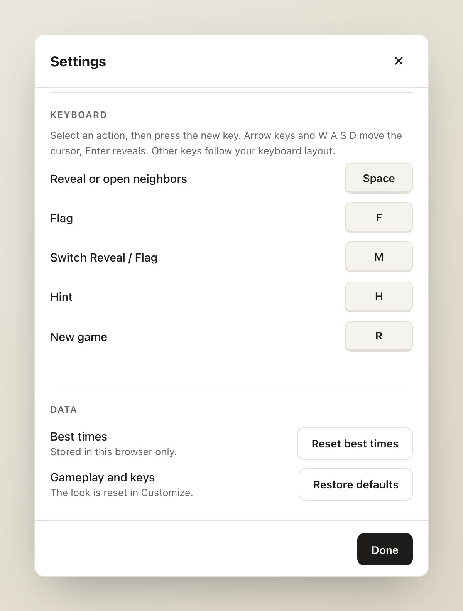
</p>

<table>
  <tr>
    <td width="50%">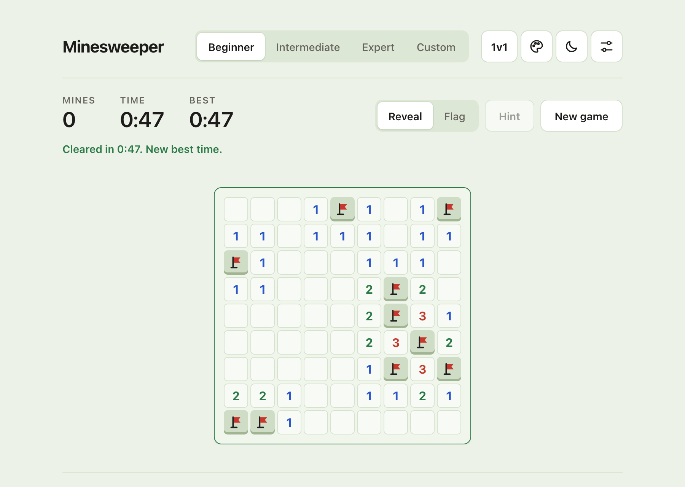</td>
    <td width="50%">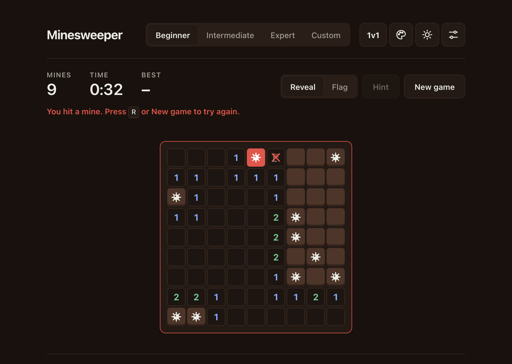</td>
  </tr>
  <tr>
    <td align="center"><sub><b>Win:</b> a green border and your time. Faster than your best? It is saved.</sub></td>
    <td align="center"><sub><b>Loss:</b> the mine you hit is red, all mines show, wrong flags are crossed out.</sub></td>
  </tr>
</table>

## Game modes

### No guessing

Turn it on in **Settings → Gameplay**. On your first click the game places the mines, then
**plays the board itself with a solver**. If the solver ever needs a guess, the board is thrown
away and a new one is tried (on Expert this usually takes a few tries and well under a second).
The solver only uses three rules that a person can use too:

1. **A single number:** if a number already has all its mines, the other neighbours are safe. If
   its hidden neighbours are exactly its remaining mines, they are all mines.
2. **Two overlapping numbers:** comparing two numbers that share cells proves cells safe or
   mined (this finds patterns like 1-2-1).
3. **The mine counter:** in the endgame, the number of mines left settles cells no number
   touches.

No-guessing games have their own best times, because they are easier than games with forced
guesses.

### Hints

The **Hint** button uses the same solver, but only looks at what you can see (revealed numbers
and the mine count, never your flags, which might be wrong). It shows, in this order:

1. a flag that is proven wrong,
2. a cell that is proven safe,
3. a mine you have not flagged yet,
4. or says honestly that only a guess is left.

A win with hints does not count for best times.

## Customize

Everything visual lives in one place, the **Customize** button (palette icon). It is separate
from Settings, which holds gameplay and keys.

<p align="center">
  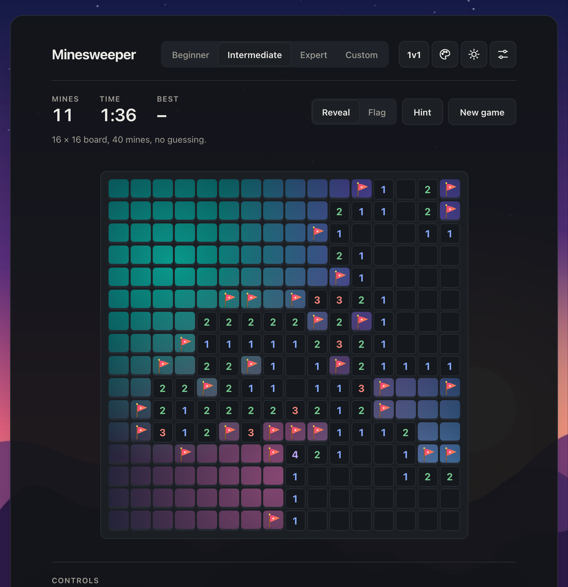
</p>

<p align="center"><sub>Slate theme with a custom background, a block picture spread over the whole board, and a custom flag.</sub></p>

<table>
  <tr>
    <td width="50%">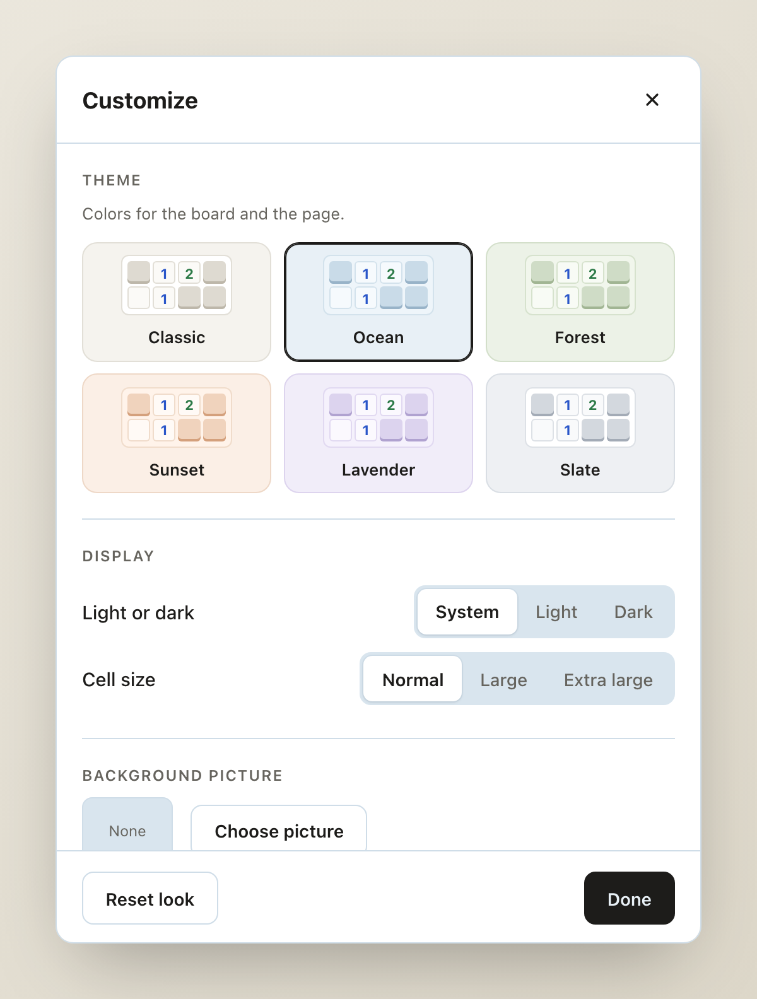</td>
    <td width="50%">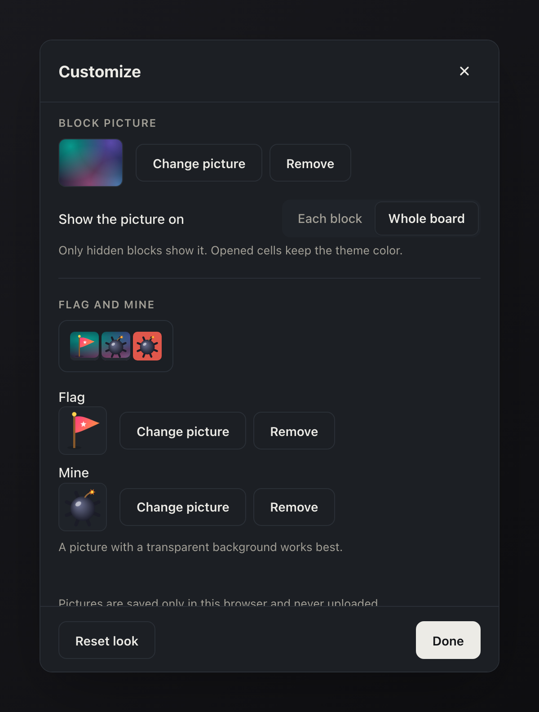</td>
  </tr>
  <tr>
    <td align="center"><sub><b>Six themes</b> that colour both the board and the page, plus light/dark mode and three cell sizes.</sub></td>
    <td align="center"><sub><b>Your own pictures</b> for the blocks, flag and mine, with a live preview that uses the real cell.</sub></td>
  </tr>
</table>

- **Theme:** Classic, Ocean, Forest, Sunset, Lavender or Slate. Every colour pair meets 4.5:1
  contrast in light and dark mode.
- **Display:** light, dark or follow the system, and three cell sizes (the top-bar moon/sun button
  is a quick switch for light and dark).
- **Background picture:** your own image behind the game.
- **Block picture:** your own image on the hidden blocks, either on **each block** or spread across
  the **whole board**.
- **Flag and mine:** your own pictures instead of the built-in drawings. A picture with a
  transparent background works best.
- **Reset look** restores everything (it asks you to click twice, because it deletes your
  pictures).

Pictures are shrunk in your browser, saved only on your device and never uploaded. PNG, JPEG, WebP
and GIF up to 15 MB are accepted (no SVG).

## On your phone

The layout adapts to small screens. Cells grow to at least 32 px (up to 40 px, or larger with the
cell size setting), the Beginner board always fits, and Expert scrolls sideways instead of
shrinking the cells. A long press flags a cell, with a short vibration if your phone supports it.

<table>
  <tr>
    <td align="center" width="33%">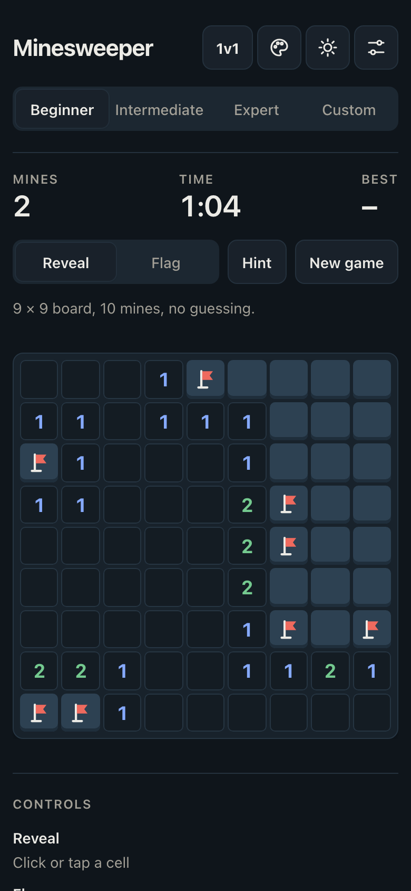</td>
    <td align="center" width="33%">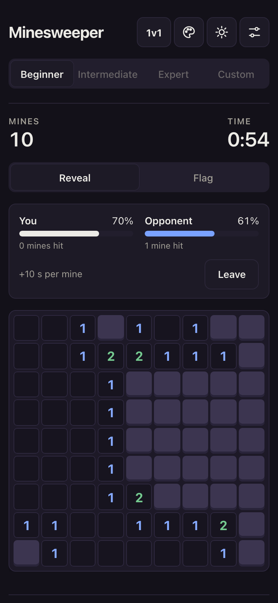</td>
    <td align="center" width="33%">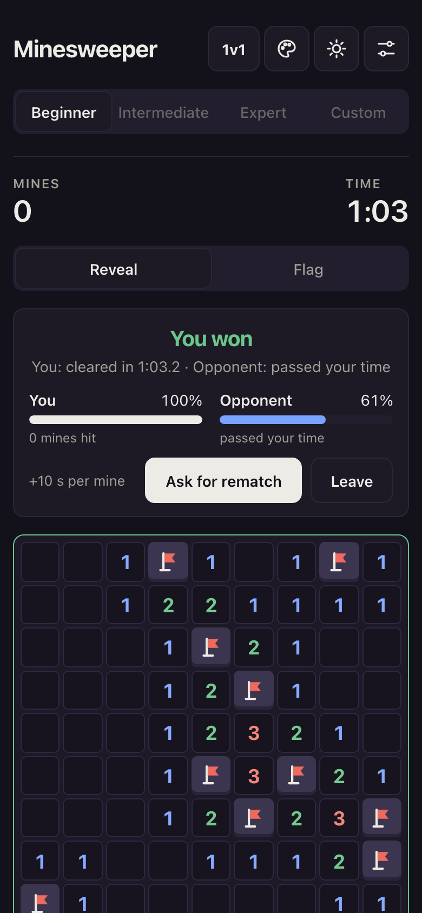</td>
  </tr>
  <tr>
    <td align="center"><sub>A normal game</sub></td>
    <td align="center"><sub>A 1v1 race</sub></td>
    <td align="center"><sub>The result</sub></td>
  </tr>
</table>

## 1v1 on the same network

Race a friend on **exactly the same board**. Both devices only need to be on the same Wi-Fi or
phone hotspot. There is no account, no login and no game server: the two browsers connect
directly (WebRTC) and you swap two short codes once, for example by AirDrop or a chat message.

<table>
  <tr>
    <td width="45%">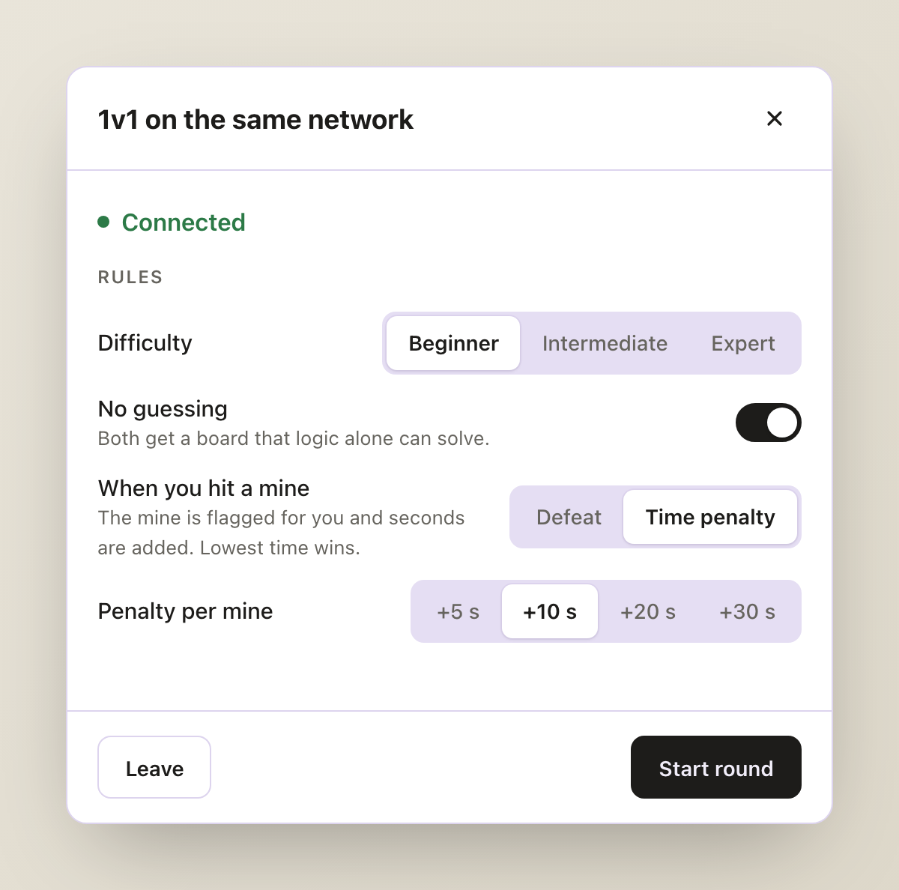</td>
    <td width="55%">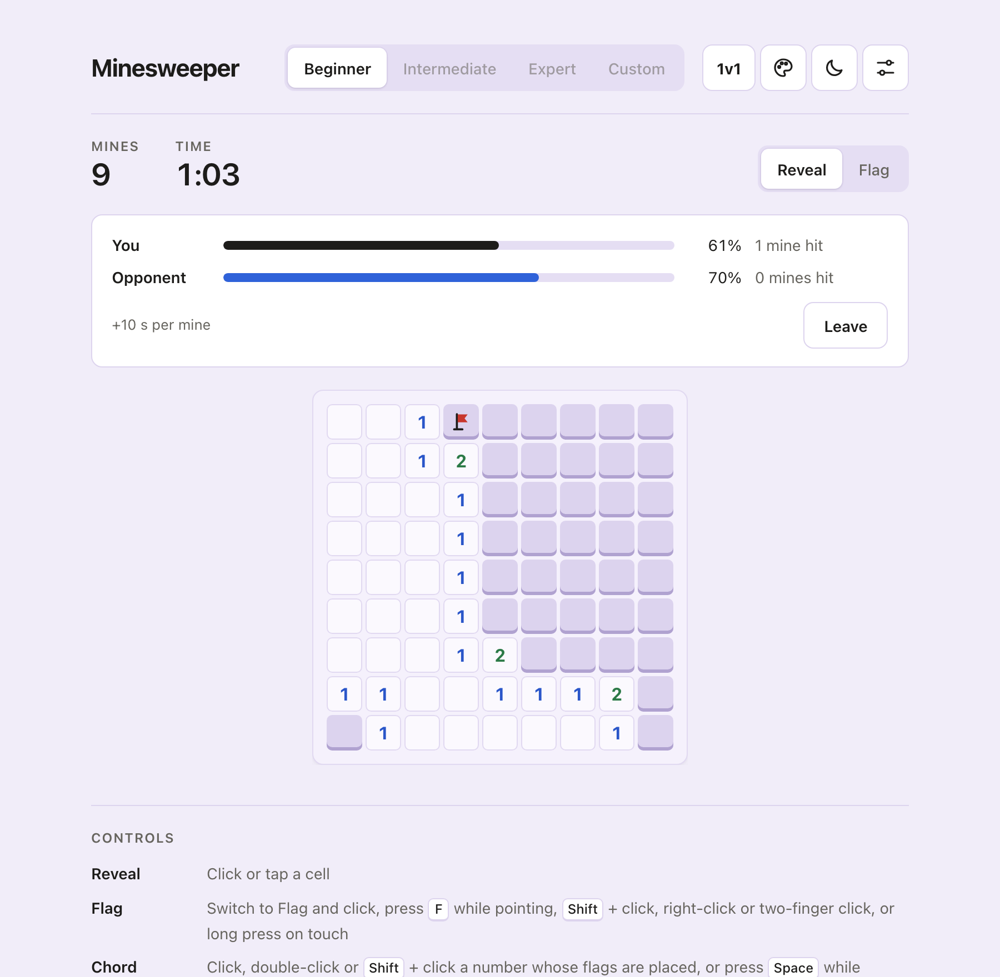</td>
  </tr>
  <tr>
    <td align="center"><sub><b>The host picks the rules.</b></sub></td>
    <td align="center"><sub><b>The race:</b> live progress for both players.</sub></td>
  </tr>
</table>

**Rules.** The host chooses them; the guest sees them but cannot change them.

| Setting             | Options                                  | Default  |
| ------------------- | ---------------------------------------- | -------- |
| Difficulty          | Beginner, Intermediate, Expert           | Beginner |
| No guessing         | On / Off                                 | On       |
| When you hit a mine | **Defeat** or **Time penalty**           | Defeat   |
| Penalty per mine    | +5 s, +10 s, +20 s, +30 s (penalty only) | +10 s    |

- **Defeat:** a mine loses the round at once. Otherwise the first to clear the board wins.
- **Time penalty:** a hit mine is flagged for you and the seconds are added to your time. The
  game goes on and the **lowest total time wins**. Once your time passes a finished opponent's,
  you can no longer win.
- **Fair start:** the host creates the board and sends the exact mine positions, and both players
  start from the same opening, so nobody has to guess the first click.

<details>
<summary><b>How to start a match</b></summary>

1. **Host:** click **1v1**, then **Host a game**. Send the invite code (it starts with `MS1.`) to
   your opponent.
2. **Guest:** click **1v1**, then **Join a game**, paste the invite code and click **Create reply
   code**. Send the reply code back.
3. **Host:** paste the reply code and click **Connect**. Both screens now say **Connected**.
4. **Host:** choose the rules and click **Start round**. After a 3-2-1 countdown the race begins.
5. Afterwards the host can click **Play again** (or **Rules** to change them), and the guest can
   click **Ask for rematch**. **Leave** ends the match.

The codes are needed once per match, rematches reuse the connection. A code contains your
device's local network address, so only send it to your opponent.

</details>

<details>
<summary><b>Trying it on two devices</b></summary>

1. On the laptop run `npm run start:lan` (allow `node` through the firewall if macOS asks).
2. Find the laptop's IP address, for example with `ipconfig getifaddr en0` on macOS.
3. Open `http://localhost:4200` on the laptop and `http://<laptop IP>:4200` on the other device.
4. Follow "How to start a match". On plain `http` the browser blocks the **Copy** and **Share**
   buttons, so select the code by hand. On the deployed `https` site they work.

A **phone hotspot** is the most reliable network. Some school, hotel and public Wi-Fi networks
block devices from talking to each other ("client isolation"), and 1v1 cannot work there.

If the page will not load from the other device, you can also run the project on both devices
(`npm start` on each) and only swap the two codes.

</details>

<details>
<summary><b>Troubleshooting</b></summary>

| Problem                                          | What to try                                                                                                      |
| ------------------------------------------------ | ---------------------------------------------------------------------------------------------------------------- |
| "Could not connect" after pasting the reply code | The network probably blocks device-to-device traffic. Use a phone hotspot, and turn off any VPN on both devices. |
| "This code is incomplete or not an invite code"  | Part of the code was lost while copying. Copy the whole code (about 600 characters).                             |
| "No address inside your local network"           | The code points outside your network, so it was refused on purpose. Make a fresh code on the same Wi-Fi.         |
| The other device cannot open `http://<IP>:4200`  | Use `npm run start:lan` (not `npm start`), check the IP, and allow `node` in the firewall.                       |
| Codes stop working                               | A code belongs to one attempt. After cancelling or reloading, start again with a new invite.                     |

</details>

## Project structure

```
src/
├── app/
│   ├── models/            Data shapes and pure rule functions (no Angular)
│   │   ├── cell.model.ts        one cell: position, mine, revealed, flagged, neighbour count
│   │   ├── game.model.ts        difficulties, game status, custom-size limits
│   │   ├── settings.model.ts    settings, key bindings and their validation
│   │   ├── appearance.model.ts  colour theme list
│   │   ├── match.model.ts       1v1 rules, messages, who wins, message validation
│   │   └── navigation.ts        arrow keys and W A S D to cursor steps
│   ├── services/          State (signals) and logic
│   │   ├── board-logic.ts       pure board functions: mines, flood fill, flag, chord, win/lose
│   │   ├── solver.ts            no-guessing boards and hints
│   │   ├── game.service.ts      the game state, timer and rules in one place
│   │   ├── best-times.service.ts, settings.service.ts, appearance.service.ts
│   │   ├── connection.service.ts, signaling.ts, match.service.ts   the 1v1 mode
│   │   └── image-resize.ts      shrinks uploaded pictures
│   └── components/        Display only: they show state and emit events
│       ├── board, cell, game-header, difficulty-picker, controls-hint
│       ├── settings-dialog, customize-dialog, picture-picker
│       └── match-dialog, match-bar
├── _board-themes.scss     the six colour themes (light and dark)
├── _dialog.scss           shared look of the dialogs
└── styles.scss            design tokens, dark mode, shared controls
public/early-theme.js      applies your saved look before the first paint (no flash)
netlify.toml               deployment settings and security headers
```

## How it works

- **Components are dumb, the service holds the logic.** Components show state and emit events
  such as "reveal" or "flag". `GameService` keeps the game in Angular **signals**, and every
  component uses `OnPush` change detection.
- **The board logic is pure.** `board-logic.ts` has no Angular in it: functions take a grid and
  return a new one, which makes them easy to test and explain.
  - Mines are placed _after_ the first click, never on the clicked cell or its neighbours
    (a Fisher-Yates shuffle over the allowed cells).
  - Empty areas open with an **iterative flood fill** that uses an explicit stack, so a huge empty
    board cannot overflow the call stack.
  - **Chording** opens all neighbours of a number once its flags match the number.
- **The solver** (`solver.ts`) powers both no-guessing boards (generate, solve, retry) and hints
  (find the next provable move). It is a few small rules, not a search.
- **1v1** uses a WebRTC data channel. The two codes are the connection descriptions, compressed
  and written as text. Messages between the players are plain JSON and are checked before use.
  `decideOutcome` is a pure function that both devices run on the same two results.
- **Looks are CSS variables.** Each theme is a set of colour tokens in `_board-themes.scss`.
  Your pictures are stored as data URLs and handed to the CSS through variables.
- **Strict TypeScript, no `any`**, and no libraries beyond Angular itself.

## Testing

```bash
npm test
```

runs the unit tests with Vitest (add `-- --watch=false` for a single run). They cover the rules
of the game (mine placement, first-click safety, neighbour counts, flood fill, flagging, chording,
win and lose), the solver and hints, the timer and best times, settings and key rebinding, themes
and pictures, the cell icons, and the 1v1 pieces (codes, message checks, who wins, the match flow
with a fake connection).

[GitHub Actions](.github/workflows/ci.yml) runs the tests, a production build and `npm audit`
on every pull request.

## Deploying (Netlify)

The settings live in [`netlify.toml`](netlify.toml), so the website form can stay at its defaults.

1. Push to GitHub and merge into `main` (Netlify builds the branch you choose, here `main`).
2. On Netlify: _Add new project_ → _Import from Git_ → pick the repository. Netlify reads
   `netlify.toml`: build command `npm run build`, publish folder `dist/minesweeper/browser`,
   Node 24.
3. Optional: _Domain management_ → _Add a domain_. HTTPS is set up automatically.

What the config does:

- **Security headers** on every file: a strict Content-Security-Policy (only the site's own files
  run or load, no inline scripts), no framing, no referrer, no camera/microphone/location,
  https only, `nosniff`.
- **Caching:** files with a hash in their name are cached for a year; `index.html` and
  `early-theme.js` are always checked for a new version.
- **CI** ([`.github/workflows/ci.yml`](.github/workflows/ci.yml)) runs the tests, the production
  build and `npm audit` on every pull request. Dependabot opens update pull requests weekly.

To try the production build locally: `npm run build`, then serve `dist/minesweeper/browser`.
On the deployed (https) site the Copy and Share buttons for the 1v1 invite codes work too.

## Security notes

The game has no server, no accounts and makes no network requests, so there is little to attack.
The few places that take outside data are checked:

- **1v1 codes** are limited in size, and only addresses inside the local network are accepted.
  A crafted code cannot make the browser contact anything on the internet.
- **1v1 messages** from the opponent must be whole numbers in a sane range and fit the board; the
  opponent cannot crash the game with bad positions. A modified browser can still lie about its
  time, which is fine for playing with friends.
- **Pictures** are limited to PNG, JPEG, WebP and GIF up to 15 MB (no SVG), are re-encoded in the
  browser, and are saved as plain base64 data that is checked again whenever it is read.
- **Everything is stored in the browser only** (`localStorage`): settings, best times, pictures.
- `npm run start:lan` opens the _development_ server to your network. Use it only on a network you
  trust, and not for the public site.

---

<p align="center"><sub>Built as a school project with Angular, TypeScript and SCSS.</sub></p>
